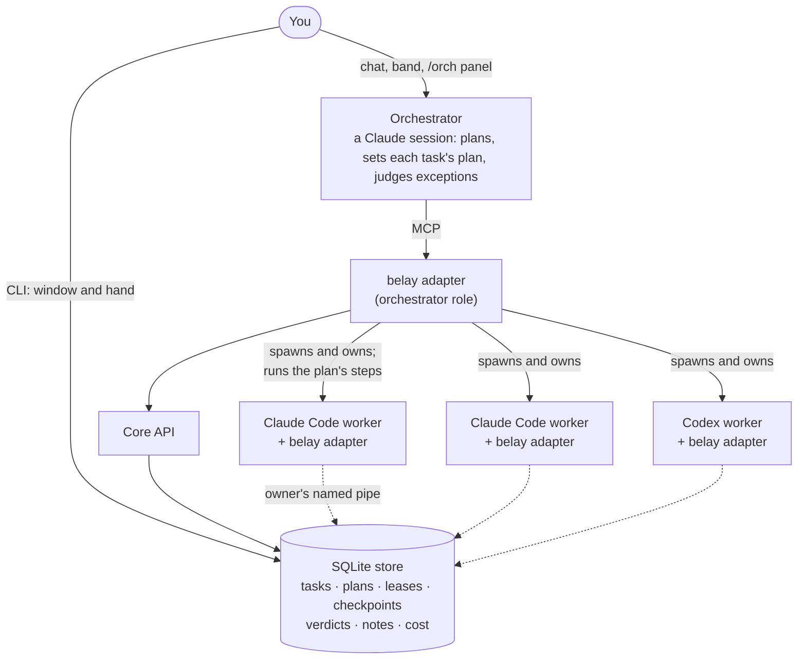

# belay

**One Claude orchestrator, many parallel coding agents, a memory that carries over, and a harness that holds the rope.**

belay runs Claude Code and Codex CLI sessions as worker processes on your machine. A Claude session acts as the orchestrator: it plans the build, sets a plan for each task, and judges what belay cannot. belay is the substrate underneath. It spawns and owns every worker, carries out each task's plan (build, review, fix, re-review, merge), keeps every task, lease, verdict and per-agent cost in one SQLite store, and lets you watch and step in from the command line or from a panel inside Claude Code.

The name is the climbing sense. A belayer does not climb. They hold the rope, keep the record and catch the fall.

`Windows 10/11 only` · `Node.js 24.19+` · `Claude Code 2.1.280+` · `Claude subscription` · `MIT`

---

## Why belay

- **Plan first, then hands off.** The orchestrator, a Claude session (headless or your own interactive one), creates the tasks with a plan for each. belay then builds, reviews, fixes, re-reviews and merges them without waking it. It is woken only at the fix-round limit, when a worker escalates, on an exception (a step that failed, a death belay could not recover, a budget pause) and once when the work is done, with a digest of the steps belay took. Results are rows in a store that outlives the session.
- **Parallel workers, each in its own worktree.** A task can get its own git worktree and branch. Finished tasks are merged into an integration branch at the exact commit that was judged, and their checks re-run on the merged head. Claude Code and Codex CLI workers can work in the same run; belay commits a Codex worker's changes when it hands back.
- **Done means checked.** Tasks carry machine-checkable acceptance commands and dependencies. A task is `done` only when its checks pass, or, for a review, when the reviewer's verdict holds. Fix rounds are counted per task, and held reviews can spawn follow-up tasks.
- **Memory that carries over between runs: notes.** Notes are on by default and live in a project namespace that outlives every run. Workers hand back notes (what they learned, when it applies, and how they know), reviewers verify them against evidence, and later workers get the closest matches in their first message and find others by hybrid keyword and semantic search. Every result says which search modes ran, so an empty page is never passed off as proof that nothing is stored. Whether notes make workers better is not yet measured; a delivered right fact has been shown to be applied (see [What we have measured](#what-we-have-measured)).
- **The harness holds the rope.**
  - Every worker is a process belay spawned and is the parent of. Liveness is derived from process exit, pid checks and event age, never from what a model says.
  - A builder or reviewer the plan gave a task that dies unexpectedly is restarted once, on its own session; one you kill or stop is left alone. Every restart resumes the worker's session when one exists, and starts fresh once if the resume does not come up.
  - Every intervention names an id and returns proof: the row written, the pid acted on, the exit code, or a refusal that says why.
  - Kills are by exact pid with proof of the process's identity. Shell commands that kill by name are refused for Claude Code workers and a headless orchestrator.
  - Claude Code workers' `git push`, writing `gh` commands and writing `git stash` commands are refused, and so are their writes to the drive's `/tmp`. Each worker gets its own temp folder.
  - A merge into one of your own branches waits for your approval by default.
  - A spend limit pauses the run and wakes the orchestrator.
- **A panel inside Claude Code.** A band above the prompt shows the run, the agent count, the cost and the newest notice. `/orch` opens a side pane with each agent's state, model, task, context size and cost.
- **Claude Code workers launch with exactly what you gave them.** No personal settings, plugins, auto memory or parent-folder instruction files. belay checks what each Claude Code worker, and the orchestrator, actually loaded at startup and fails the launch if it differs.
- **A durable record.** Tasks, plans, leases, checkpoints, verdicts, belay's own steps, per-agent cost and each task's check history stay in the store after the run, so you, or a later session, can read what happened.

Claude Code's own subagents can also run in parallel, be messaged and stopped, and take a model and effort each, and Claude Code watches for stalled agents. belay is not a replacement for them, and nothing has measured it against them. It is a different shape: workers as owned processes, coordinated through a store, with a plan belay carries out between the orchestrator's decisions, and a human holding the controls.

---

## Install

**Requirements**

| | |
|---|---|
| Windows 10 or 11 | The only supported platform for now (see [Limitations](#limitations)). |
| Node.js 24.19.0 or later | belay uses Node's built-in `node:sqlite`. |
| Claude Code 2.1.280 or later | Signed in with your Claude subscription. A worker or headless orchestrator billed any other way is refused. |
| git and PowerShell | Both standard on a Windows developer machine. |
| Codex CLI (optional) | Only if you want Codex workers. Sign in with `codex login`. |

**Install from GitHub** (belay is not on the npm registry):

```powershell
npm install -g github:aschwa1012/belay
belay doctor              # one line per check, each with its evidence
```

`belay init` (below) offers to download the embedding model note search runs on (about 252 MB, once per machine); `belay embedder fetch` does the same at any time. To pin this release, install `github:aschwa1012/belay#v0.4.0`. npm may warn about install scripts for `onnxruntime-node` and `protobufjs`; they come from the optional embedding library and are harmless. Do not install with `--omit=optional`, or `belay run` will refuse to start. Full details, troubleshooting and how to point belay at a specific `claude.exe`: [INSTALL.md](INSTALL.md).

> **Upgrading from 0.3.3?** Runs now take a plan by default: belay builds, reviews, fixes and merges each work task and wakes the orchestrator only for exceptions and the done digest (`"policy": null` in a spec restores the old flow). Notes are on by default, under a project name taken from the git remote or the folder (`belay settings memory.notes false` turns them off). The store moves to schema version 3, which 0.3.3 cannot open: back up `.belay\` first. Copy the prompt template again. See [INSTALL.md](INSTALL.md#updating) and [CHANGELOG.md](CHANGELOG.md).

---

## Quickstart

In a git repository you are happy for agents to change (a scratch clone is ideal):

```powershell
cd C:\path\to\your-project
belay init      # writes belay.config.json with a notes project, creates .belay\ (add it to .gitignore), offers the model download

# Copy the interactive orchestrator prompt next to your spec
Copy-Item "$(npm root -g)\@aschwa1012\belay\src\run\prompts\orchestrator-interactive.md" .\prompt.md
```

`belay init` names the notes project from the `origin` remote (`owner-repo`), else the folder, and prints it; change it with `belay settings memory.project <name>`. In a terminal it asks before downloading the model; `--fetch` and `--no-fetch` answer for it.

Create `belay-spec.json`:

```json
{
  "worktree": ".",
  "prompt_file": "./prompt.md"
}
```

Start the run:

```powershell
belay run belay-spec.json --interactive
```

Claude Code opens in your console as the orchestrator. If it asks whether to trust the folder, answer yes; declining ends the run. belay passes no first prompt, so type your brief, for example:

> Add a `--verbose` flag to the CLI in `src/cli.js`. Acceptance: `node test/cli.test.js` exits 0.

From there:

- The orchestrator creates the tasks and ends its turn. Under the default plan, belay spawns a coder for each task once its dependencies are done, a reviewer when the coder hands back, sends a refuted review's findings back to the coder, and merges the work into `belay/integrate/<run>` once a review holds. It wakes the orchestrator in the same session for exceptions and once when everything is done.
- The band above the prompt shows the run; type **`/orch`** for the side panel.
- From a second terminal: `belay status`, `belay agents`, `belay notices`, `belay pause <worker-id>`, `belay message <worker-id> "<text>"`.
- The run ends when you quit the session. `belay receipts <run-id>` gives the per-agent breakdown and belay's steps.

**Headless.** Leave out `--interactive` and `belay run` drives a headless orchestrator (`claude -p`) from start to finish. Its prompt must carry the brief: copy `orchestrator.md` instead and append your brief to it, or name a brief with `"brief_file": "./brief.md"` in the spec and belay wraps it in its current template. Follow it with `belay transcript -f`, `belay agents` and `belay notices`.

---

## How it works



- **The orchestrator is a Claude session, not code.** It creates tasks with acceptance criteria and a plan, and decides whatever the plan leaves to it: what to do at the fix-round limit, after an escalation or a failed step, and whether the run is done. belay never judges the work; reviewers and acceptance checks do.
- **belay is deterministic code.** Spawning, leases, a checkpoint after every worker turn, death detection, restart from the last checkpoint, running acceptance checks, merging, and the steps a task's plan names are belay's job.
- **Workers are real processes.** Each worker has its own context window and its own belay MCP adapter; its identity is in that adapter's command-line arguments, never in a prompt. One worker crashing does not take the run down.
- **No daemon.** The process that owns the store is elected on demand and stops when its last client leaves. Nothing keeps running after you are done.

---

## Working with a run

### Watch and intervene

Every command declares one mode: **R** read-only (starts no process, creates no file; the exceptions are `mcp status --deep` and `doctor --fix`), **W** store client, **C** run control over a pipe belay owns. `--json` gives machine-readable output; `--data <dir>` picks a data directory.

| Command | Mode | What it does |
|---|---|---|
| `status [run-id]` | R | Status as six rungs, each naming its evidence; each task's plan, and belay's steps with each turn's cost |
| `agents [run-id]` | R | The orchestrator and each worker: model, effort, state, context, cost, start and exit times |
| `workers` / `tasks [run-id] [--all]` | R | Worker rows with derived liveness; task rows with lease, holder and checkpoint |
| `notices [run-id]` | R | Permission and merge requests, dead or stalled workers, verdicts, budgets, pause and end |
| `transcript [run-id] [-f]` | R | A headless orchestrator's stream, readable |
| `logs <worker-id> [-f]` | R | A worker's raw stream |
| `receipts [run-id]` | R | Per-agent model, turns, tokens, cost, tool calls, wall clock, checks, and belay's steps |
| `usage [run-id] [--by task\|worker\|model\|turn]` | R | Tokens and dollars per turn (needs the cost ledger, which a budget turns on) |
| `diff [run-id] [--since ts]` | R | Rows changed since a mark |
| `worktrees [run-id] [--all]` | R | Each task's worktree and branch, and the run's integrations |
| `briefing <worker-id>` | R | The resume material a worker would get |
| `pending [--all]` | R | Tool calls and merge requests waiting on a verdict |
| `config [path\|get <key>]` | R | Which config file is read, and effective values with their sources |
| `doctor [--fix]` | R | Checks config, store, Claude Code and Codex binaries, embedder (`--fix` only creates a missing data dir) |
| `mcp status [--deep]` | R | MCP server facts, one by one |
| `init [--fetch\|--no-fetch]` | W | Write `belay.config.json` with a notes project, create the data dir (never overwrites), offer the model download |
| `run <spec.json> [--interactive] [--effort level]` | W | Start a run; the store owner for its lifetime |
| `settings [<key> [<value>]]` | W | Panel settings, memory defaults, per-agent-type model and effort defaults |
| `embedder fetch\|verify\|delete` | W | Download, re-hash or delete the embedding model, a reranker, the GPU runtime or a GPU model |
| `worktree create\|remove\|merge\|prune` | W | A task's worktree and branch; merge tasks into an integration branch; prune lapsed runs' trees |
| `stop <run-id>` | C | Stop a live run and reap its workers |
| `pause` / `resume <worker-id\|run-id>` | C | Park a worker (or a whole run) and relaunch it on its session; `resume` also takes the budget options below and `--embedder keyword\|off` |
| `message <worker-id> <text>` | C | Send a turn to a worker |
| `worker kill\|rm\|stop\|restart <worker-id>` | C | Kill by exact pid (a plan does not restart it), forget a dead worker, stop it, or restart it on its session |
| `task assign <task-id> <worker-id>` | C | Assign an open task |
| `take-control <task-id>` | C | Move a task's lease to you and pause its worker |
| `approve` / `deny <request-id>` | C | Answer one pending tool call or merge request |

The `memory` commands are listed under [Memory](#memory-notes). Every intervention returns proof: the row it wrote, the pid it acted on, the exit code, or a refusal that says why. Control commands must come from your own terminal; from Git Bash some are refused (see [Limitations](#limitations)).

A worker the orchestrator spawns without naming one gets a readable id such as `coder-1` or `reviewer-2`; workers a plan spawns are named `bld-…` and `rev-…`.

### Plans

A task's plan (`policy` on `task_create`) names the steps belay takes for it: `build` (spawn a coder, or give it to a named worker, once its dependencies are done), `review` (spawn or name a reviewer once the work is done), `fix: "builder"` (a refuted review, a merge conflict or a failed check goes back to the builder as a fix round), `re_review: "refuter"` (the reviewer that refuted checks the fix), `integrate: "on_hold"` (merge once the review holds) and `follow_up: "plan"` (a hold with should-fix findings becomes a follow-up task the plan builds too).

- **The default plan** is every one of those steps, with a spawned coder and reviewer. Set your own in the spec's `policy`, or as `run.policy` in `belay.config.json`, field by field; `"policy": null` in a spec runs with no plan, and the orchestrator takes each step itself. The orchestrator can give a task its own plan, set a field to `null` to keep that step, or hand the task back.
- **Fix rounds** count against `max_fix_rounds` (default 2) per task. At the limit belay stops the task's steps and wakes the orchestrator with the cause.
- **What wakes the orchestrator:** the fix-round limit, a worker's escalation, a step that failed or that the plan leaves to it, a death a restart did not recover, a budget pause, 80% of a headless run's time bound, and once when every task is done, reviewed, merged and the merged head's checks pass. A check that failed and passed on a retry is only noted. Each wake carries a digest of the steps belay took since the last one.
- **Bounds.** `max_parallel_builds` (default 4) caps the builds in flight. Workers a plan spawned are stopped once their work is merged.

### Parallel tasks and merging

- **A tree per task.** The orchestrator can create a task with its own worktree and branch in the same call, or a batch of up to ten tasks at once, at most four of them with trees (all or nothing). A task that depends on others gets its tree from the integration branch once they are merged. Tasks on the same files need separate trees; belay refuses the overlap.
- **Integrate.** `integrate` merges finished tasks into `belay/integrate/<run>` at the commit that was judged, re-runs their checks on the merged head (plus any checks of its own), and reports conflicts and what was left out. When a hand-back passes, belay also forecasts whether its branch will conflict with the integration branch. `max_parallel_evaluations` caps how many checks run at once. A conflict stops and leaves the tree clean; belay never forces or pushes.
- **Your branches ask first.** With `merge_into: "ask"` (the default), integrate moves a branch of yours only after your approval and passing checks. In a headless run the approval is a request only you can answer, through `belay pending`, `approve` and `deny`. In an interactive run the orchestrator asks you in chat and records your answer (`approved_in_chat`); belay cannot see the chat, so there it takes the orchestrator's word. `"allowed"` lets it move your branch without asking.
- **Runs keep to their own work.** Integrate refuses work another run made unless the spec sets `cross_run_merge`.
- **Cleanup.** `belay run` removes each finished, clean task tree when the run ends. `belay worktree prune` removes the trees of runs whose run process is gone (a preview unless `--yes`). Removing a tree keeps its head commit under a `refs/belay/kept/` ref; the prune lists those refs, and `--yes --drop-pins` drops the ones a branch of yours already reaches.

### Spend limits

Set `budget_usd` in the run spec, or `run.budget_usd` in `belay.config.json` as a default (`null` in a spec turns the default off for one run). Tasks can carry their own budget. Budgets are off by default.

- When spend nears the limit (90% of it), belay pauses the run and wakes the orchestrator, and its plan sends no more work; `belay status` shows the budget beside the spend.
- Resume with a higher limit (`belay resume <run-id> --budget <usd>`, or `--task-budget <task-id> <usd>`) or lift it for the rest of the run (`--over-budget`).
- Figures are what the agent CLIs report, at API rates. Claude Code reports a worker's cost when its turn ends, so a long turn can overrun; `budget_counts_in_flight: true` also counts running turns as a labelled estimate.
- A headless orchestrator's cost counts when its turn ends, which is normally at run end. An interactive orchestrator's cost is not counted. Codex workers report no dollars, so their cost counts as unknown and the figure reads "at least".

---

## Memory: notes

belay's memory is its notes: short claims workers hand back at the end of a task, kept in a project namespace that outlives any one run. They are the only memory belay's agents have: each worker's own Claude Code auto memory is switched off at launch. Notes are experimental, and on by default.

The project name comes from `memory.project` when it is set (`belay init` writes it). Otherwise each run derives it from the `origin` remote, else the folder name, prints it with its source at start and records it on the run. `belay settings memory.notes false`, or `"memory": null` in a spec, turns notes off.

**Writing and checking notes**

At the end of a task a worker can hand back up to 10 notes: a one-line claim, the situation that would run into it, how it knows (observed, inferred or relayed) and, when observed, its evidence. Each worker is also told when and how to search the notes.

- **The task's reviewer** gives each note of the work it reviews a verdict that must quote what it checked. Apart from your own `belay memory verify`, only such a cited verdict makes a note verified.
- **Reports.** A worker, a reviewer, the orchestrator or you (`belay memory report <note-id> --reason <text>`) can report a note wrong. The note is held, and by default (`held_visibility: withhold`) left out of workers' reads until it is settled. A per-run breaker (`held_breaker_count`, `held_breaker_share`) bounds how many notes one run's reports can withhold.
- **The archive review.** `belay memory review` (or the review button on the panel, two presses) starts one Opus 5.5 child, capped at $2, over the held queue. It archives or releases a note only on cited evidence, and otherwise leaves it for you. `belay memory held settle` settles one yourself.
- **The scrub at run close.** Haiku 5.5, capped at $0.10 and 300 s, proposes which new notes repeat, replace or refine stored ones. It runs at every close with new notes to compare. Nothing is archived or merged without you (`belay memory proposals`).

**Finding notes**

- **The note index in a worker's first message.** When a worker is spawned or relaunched for a task, belay lists up to 3 stored notes (1,600 bytes at most) that match the task. The orchestrator gives each task up to four short search lines (`memory_queries`), naming the files, commands or behaviour the task touches; review, fix and follow-up tasks inherit them. A note is listed when it is close to one of those lines, or very close to the whole task text. When none is close enough, the worker is told how many notes the project has and to search before it changes a file or command.
- **Hybrid search that says what it did.** Keyword and semantic results are fused. Every result names the modes that ran (`modes_run`), the ones that failed and why (`modes_failed`), and `absence_established`, true only when both modes searched every note in scope and found nothing. Without the embedder, a CLI search runs keyword only and says so.
- **A compact view.** `view: index` returns ids, statuses and titles, so an agent can scan many notes and open only the ones it needs. There is also a timeline around any note, and filters by status, worker, task, run and time.
- **Retrieval profiles.** Note search runs on the CPU embedder by default (`cpu-fast`); profiles that rerank, or embed on a GPU, can be chosen per run and per agent type (`belay memory menu`).

**Safety**

- **Provenance.** Each note records the run, task and worker that wrote it. These come from the worker's lease and launch arguments, not from anything the model says.
- **Redaction.** `<private>` spans, API keys, tokens, private keys, bearer headers, URL credentials and secret-looking values are removed before a note is stored, and redaction cannot be turned off while notes are on. It is pattern matching and will miss things, and a worker's raw stream log is not redacted.
- **Memory is data, not instructions.** Every block of memory an agent reads is framed between `BEGIN MEMORY` and `END MEMORY`, and nothing a model wrote can start a line of its own inside it. A worker reads only its own run's and its project's memory, and cannot choose a note's id, author, time or vector.

**Levers.** Set in the run spec's `memory` block, or as defaults with `belay settings memory.<lever> <value>` (a spec's own block wins). A lever that needs another, an unknown key or a bad value is a usage error that names the key.

| Lever | What it does |
|---|---|
| `project` | Names the project namespace (derived from the remote or folder when unset) |
| `notes` | On by default; `false` turns notes off |
| `held_visibility` | `withhold` (default) or `warn`: whether workers see a reported note before it is settled |
| `held_breaker_count`, `held_breaker_share` | The breaker's limits (default 5 and 0.2, the share never below 3 notes) |
| `scrub_action`, `scrub_model`, `scrub_cost_cap_usd`, `scrub_wall_s` | The run-close scrub: `off`, `propose` (default) or `apply`; Haiku 5.5, $0.10, 300 s |
| `archive_review_auto`, `archive_review_model`, `review_cost_cap_usd`, `review_wall_s` | Run the archive review at run close too (default off); Opus 5.5, $2, 600 s |
| `first_message_index`, `index_bytes`, `index_max_notes` | The note index in each worker's first message (on with notes; 1,600 bytes, at most 4,096; 3 notes) |
| `index_min_relevance`, `index_min_relevance_spec`, `index_spec_only_floor` | How close a note must be to a search line (0.45), to the whole task text (0.60), or to the task text when it has no lines (0.55); provisional |
| `on_embedder_failure` | `required` (default: a failed embedder pauses the run), `keyword` or `off` |
| `profile`, `profile_cpu`, `routing`, `routing_cpu` | The retrieval profile (`cpu-fast` default; CPU rerank and GPU profiles), and a profile per agent type |
| `on_heavy_failure`, `on_heavy_behind` | What happens when a reranker or GPU embedder fails, or has notes left to embed |
| `alpha` | Semantic weight in hybrid search, 0 to 1, default 0.5 (provisional) |
| `search_log` | Record each search's query, candidates and order (default off; keeps query text) |
| `turn_rows` | Store each worker turn's last text as a row (default off) |
| `knowledge_agent` | A read-only worker the orchestrator can ask about stored notes (default off) |
| `cost_ledger` | Tokens and dollars per turn, for `belay usage` (a budget turns it on) |

**Commands**

```powershell
belay memory search "lease expired"                    # hybrid; check modes_run and absence_established
belay memory search "lease expired" --mode keyword     # needs no embedder
belay memory list --type note --task <task-id>         # filter notes
belay memory show <id>                                 # a note in full
belay memory timeline <id> --before 5 --after 5        # what was written around a note
belay memory verify <id> --status refuted --receipt commit:3e1de17   # your own verdict, with a receipt
belay memory stats                                     # counts by type and status
belay memory export --out rows.jsonl                   # never overwrites a file; --all for every row
belay memory import rows.jsonl --namespace-map run/old=project/my-app   # arrives unverified
belay memory held [--awaiting]                         # held notes, by ground
belay memory held settle <note-id> --archive --reason "<why>"   # or --release, --reoffer
belay memory report <note-id> --reason "<why>"         # report a note wrong
belay memory review                                    # the archive review of the held queue
belay memory proposals                                 # the scrubber's proposals
belay memory menu                                      # retrieval profiles, routing and models with their state
```

Also: `memory restore`, `resolve`, `promote` (a note nominated for an instruction file), `archive purge`, `embed`, `scrub` and `search-log`; `belay --help` lists them all. Retrieval profiles that rerank or run on a GPU need their models fetched first; see [INSTALL.md](INSTALL.md#fetch-the-embedding-model).

Notes are belay's default memory. The older memory from before notes (free-form rows, turn capture and mechanical summaries, with their levers) stays off unless you turn its levers on, and is not recommended.

---

## Configuration

- **`belay.config.json`** is found by walking up from the current directory to the project root (never into your home directory). Keys: `data_dir` (default `.belay`), `claude_exe`, `codex_exe`, the panel's `mod.*` settings, `run.budget_usd`, `run.policy` (a default plan), a `memory` block of lever defaults, and an `agents` block of per-type defaults (`agents.reviewer.model`, `agents.coder.effort`, `agents.<type>.codex_model`, `agents.<type>.tools`, `agents.orchestrator.model|effort`). `belay settings` lists and sets the `mod.*`, `memory` and `agents` keys; `belay config` shows where each value came from.
- **Defaults.** The orchestrator runs Opus 5.5. Coders and testers run Sonnet 5.5; reviewers and researchers Opus 5.5 at effort high. Coders, testers and reviewers get Read, Edit, Write, Glob, Grep and Bash; researchers get Read, Glob, Grep, WebFetch and WebSearch, with no shell. A spawn can narrow a type's tools, never widen them.
- **The run spec** (`belay run <spec.json>`) needs `worktree` and one of `prompt_file` (your own copy of a template) or `brief_file` (your brief inside belay's current template, which an upgrade refreshes). Common optional keys: `mode`, `model`, `timeout_ms`, `policy`, `max_fix_rounds` (default 2), `fix_hard_cap`, `max_follow_ups` (default 1), `max_parallel_builds` (default 4), `max_parallel_evaluations`, `merge_into`, `cross_run_merge`, `budget_usd`, `budget_counts_in_flight`, `permission_prompt` and a `memory` block. An unknown key is an error. Full list: [INSTALL.md](INSTALL.md#run-spec-keys).
- **The worker environment** is an allowlist. API keys, tokens and billing variables are not passed; the exceptions are `CLAUDE_CODE_OAUTH_TOKEN` (a subscription sign-in) and `SSH_AUTH_SOCK`, which goes to the orchestrator only. Name extra variables a build needs in `BELAY_ENV_ALLOW` (comma-separated); credential and billing names there are refused, and so is a launch that names one. `TEMP`, `TMP` and `TMPDIR` point at the worker's own temp folder, which belay removes when the run ends.
- **Finding Claude Code and Codex:** `BELAY_CLAUDE_EXE`, then `claude_exe`, then `claude` on PATH (Codex likewise with `BELAY_CODEX_EXE`, `codex_exe`, `codex`). `belay doctor` shows which it found and why.
- **Watching from a second window.** Any run, headless or interactive, can be watched from another Claude Code session: `claude --plugin-dir "$(npm root -g)\@aschwa1012\belay\src\mod"`, then `/belay watch [run-id]` and `/orch`.

---

## Design rules

These are settled rules of the codebase, not aspirations:

- **belay is the parent of every worker.** No worker exists that belay did not spawn and cannot see exit.
- **No daemon.** The store owner is elected on demand and never outlives its clients.
- **Identity comes from process arguments only,** never from a prompt or anything a model says. A worker cannot name itself.
- **Liveness is derived, never self-reported.** Each status rung names what established it.
- **No success without effect.** Every write returns the row it wrote or an error.
- **Reading never writes.** Read commands copy the database and read the copy.
- **Kills are by exact pid, with proof of identity:** a live child handle, or the creation time recorded at spawn matched against a fresh snapshot. If identity cannot be proved, the kill is refused and you are told how to end the process by hand.
- **Control travels only on pipes belay owns.** Messages between sessions carry no authority.
- **Budgets are real and gated in the test suite:** read commands add under 500 ms over Node's own start-up, status costs under 100 ms in process, a hook injects at most 400 bytes per event, and no read path loads the embedding library.

---

## What we have measured

Experiments on search and on whether memory helps were pre-registered: cases, measures and the bar for success were fixed before any result was seen.

- **Plan-first runs (0.4.0).** On the last two release candidates, ten headless runs of the same 7-ticket build of a small command-line product were started under the shipped plan. Five are counted. Not counted: three runs that showed defects since fixed (a false stall wake, and a note index that listed nothing), and two that were stopped before they finished. The five counted runs cost about $7 to $10 each (one used Codex coders, whose cost is not reported). In two, the orchestrator's only wake was the done digest. In the other three it was also woken at the fix-round limit by a merge conflict that kept recurring. Five runs of one build are a pilot, not a benchmark.
- **The note index (0.4.0).** In two of the counted runs, on the release code, the orchestrator wrote search lines for every work task, and each of the 40 workers spawned got 1 to 3 notes listed. By one reader's judgement about 60% of the listed notes were on-task. Reviewers opened listed notes (15 of 20) and in a few cases visibly acted on them; no builder did. This shows the index delivers, not that it helps.
- **Parallel runs (0.3.1).** The same 10 tickets of a small command-line product were run twice in parallel, headless, with the orchestrator choosing how to split them. Each run took about an hour (59 and 64 minutes) against about 5 hours one ticket at a time on an earlier build, and cost $18.68 and $16.20 against $28.31. Both met the quality bar fixed before the runs (hidden regression tests at 0.914 and 0.919 against 0.928, with 0.05 allowed), and 5 of 9 scored tickets passed all their own tests, as in the sequential run. Two runs on one product are a pilot, not a benchmark.
- **A first memory experiment found no benefit, from a flawed design.** 54 small coding tasks with and without a memory index (and a same-size placebo) all passed alike, and memory cost about 18% more. Most facts memory could supply were already in the task text or files the worker read, and the index showed the wrong rows; both were fixed for the next experiment.
- **A delivered right row was applied every time.** Eight tasks each hid a trap in a fact the code cannot reveal. Sonnet 5.5 avoided the trap in 0 of 24 runs with no memory, 0 of 24 with placebo rows, and 24 of 24 with the right row in its first message, at the same cost as no memory. The rows were hand-written in a store of eight; this shows a delivered fact gets applied, not that belay captures and finds such a fact unaided. When belay captured the fact itself, it was applied in 7 of 24 sessions with nothing else stored (inconclusive against our bar), and in 1 of 24 among 1,752 other rows.
- **A 40-task build with notes on (0.3.0).** belay drove a 40-task build of a small product on real Claude Code, one task per run with a coder, a reviewer and fix rounds. Every task landed and every run ended normally, for $103.79. Workers wrote 101 notes; 72 were found by a worker other than their writer, and 30 were verified. With no notes-off comparison, this shows notes work end to end, not that they help.
- **What notes cost.** In one small paired run (8 pairs of Sonnet 5.5 sessions on a fresh, empty store), notes added 2,014 bytes to a worker's first message and $0.0187 per session on average (standard error $0.0071; pairs ranged from -$0.016 to +$0.052). That is not a cost to expect in a store that holds many notes.
- **Hybrid search** beat semantic-only on held-out queries by a margin too small to confirm (mean reciprocal rank +0.023, 95% interval -0.004 to +0.053), with the clear gain on file-path queries (0.58 to 0.85); plain-language queries were flat and past-decision lookups lost a little (0.735 to 0.696). It is the default because it fixes semantic search's weak spot: exact paths, identifiers and error text. That comparison used a semantic weight of 0.3; the default is now 0.5, from a later comparison whose relevance labels were made by a model and have not yet been checked by hand.

Nothing has measured belay against native Claude Code agents, and we make no claim that it gives better results.

---

## Limitations

- **Windows only.** Off Windows, identity-checked kills are refused and processes can be left running. Do not try it on macOS or Linux yet.
- **Subscription only.** A Claude Code launch billed by API key or any other source is refused. A Codex worker that signed in through `OPENAI_API_KEY` no longer can; sign Codex in with `codex login`.
- **No sandbox.** A worker acts with your permissions, and a program it runs can write anywhere you can. Worktrees, file holds and tool lists keep agents apart from each other; they do not contain them.
- **The guards match command text.** The push, stash, `/tmp` and kill-by-name guards are a safety net, not a parser: a command built at run time, or a script written and then run, can escape them. They apply to Claude Code workers (and, except the push and stash guards, a headless orchestrator), not to Codex workers.
- **Spend limits are estimates.** A turn's cost is known when it ends, so a long turn can overrun; an interactive orchestrator's cost is not counted.
- **Restart cost is counted from what Claude Code saves.** A restart resumes the worker's session, and its cost is counted from the session total Claude Code saved at the worker's last graceful exit. That behaviour was measured on Claude Code 2.1.321; a version that saves it differently could make a resumed worker's figure wrong.
- **The orchestrator's restraint is a prompt rule,** and reviewer severity is a prompt rubric; reviewers have under-rated real defects. A plan the orchestrator gives a task replaces the run's plan field by field, so a partial plan on a hand-made fix can leave out the review and merge steps.
- **Codex workers** cannot be paused or parked, still load `$CODEX_HOME/AGENTS.md`, and Codex adds a trust entry for each worktree to your `config.toml`. belay commits their changes with your repository's git identity, and a fix round that needs a merge or rebase goes to a Claude Code coder. A restart whose Codex thread has expired on the server, and that fails only after it started, gets no fresh fallback.
- **Control commands need your own terminal.** belay checks that a command needing your authority comes from your own terminal, and refuses one from a shell it cannot trace to you, such as a detached launcher whose parent has exited or a shell another program spawned. From Git Bash such commands can be refused too; use PowerShell or cmd.
- **Interactive merge approval is the orchestrator's word.** In an interactive run, belay cannot see the chat, so a merge into your branch rests on the orchestrator recording that you agreed.
- **The orchestrator's cost in the panel is an estimate** for an interactive run, worked out at API rates from Claude Code's session transcript (shown as ≈$). After a `/clear`, the figures stay those of the session belay launched. A model switch in an interactive orchestrator is not recorded.
- **The panel** depends on Claude Code's plugin engine. It starts one short belay process per refresh: every 5 s with the pane open, 10 s for the band alone, 60 s once the run has ended. On Windows each launch adds to kernel memory over a long session, so end the session once its run is over.
- **Avoid the left arrow key in an interactive orchestrator session.** It can open Claude Code's session switcher. Wakes that arrive meanwhile are held, the status line says so, and they are sent when the session takes them again; that the session always takes them again is not proven.
- **The embedder is required for a run** (an optional npm dependency plus a ~252 MB model). Read commands work without it. With the default `on_embedder_failure: required`, a run whose embedder fails pauses, and a worker's memory search fails rather than falling back to keyword search; running out of time for the note index does not pause a run. Continue with `belay resume <run-id> --embedder keyword|off`; that choice is also written to the config file as `memory.on_embedder_failure`, so later runs inherit it.
- **A copied prompt does not update itself.** Copy the template again after an upgrade (`belay run` warns when your copy is older), or use `brief_file`.
- **One store owner,** single-threaded. Read commands copy the store, so they slow down on stores of tens of thousands of rows.
- **Memory is early.** Only delivery of a known-right row has been shown to help. Notes are experimental: they have run end to end in one 40-task build and in the 0.4.0 runs above. In separate tests with thousands of notes, the first-message index and search rarely surfaced the one note that mattered. Keyword search ignores terms under three characters (and says so). Known limits of notes:
  - The index's thresholds were set on one project with the default embedder. With another embedder, or keyword search only, no note passes them and the index lists nothing.
  - The index is built when a worker is spawned or relaunched. A task handed to a worker that is already running, such as a fix round sent back to its builder, gets no index.
  - The hybrid search weight (0.5) is provisional.
  - Notes written by reviewers are never judged, and the orchestrator's notes have no task reviewer.
  - Notes do not go stale when the code changes; a note records no commit.
  - Withheld notes wait on you unless `archive_review_auto` is set.
  - The breaker is per run; many runs that each report a few notes are not limited.
  - A reviewer given its task after spawning sees no notes to judge.
  - A panel review for a live run is cut when that run closes; the notes stay held.
  - A note's status and "written by" record what was claimed. They are strong against accident, not proof against a hostile process of your own user account: a worker adapter's control pipe still believes the role it is sent, so a same-user process (a worker's own child among them) can stop, pause, restart or message the workers of its run; a few narrow races in process-snapshot timing and teardown remain (see [CHANGELOG.md](CHANGELOG.md)).
  - Two narrow races: a reviewer's captured note brief can be overwritten by a second reviewer's if the first capture stalls while you release its lease, and a replaced worker whose carried-notes record fails three writes can later miss a note at resume.
  - `belay memory held` shows each report's latest reason; a reporter's repeat replaces its earlier report.
- **File holds across runs.** A parked worker of an ended run that is adopted or resumed after another run took overlapping files can launch without its file hold re-established. Normal assignment refuses the overlap.
- **Interfaces may change.** belay is early and built by one developer; spec keys and the store layout may change between releases.

---

## Roadmap

belay drives real multi-agent runs today, and parts of belay itself were built by belay runs: a coder, a reviewer, fix rounds and a second reviewer, unattended, with a receipt for every agent. Directions, with no dates and no promises:

- **macOS and Linux.**
- **Memory that pays off:** an evaluation of notes on a real project build, with a held-out set and a native-memory baseline; better ranking; a model-written summariser; judging reviewers' notes.
- **Several orchestrators** coordinating as peers over one store.
- **More worker substrates,** including open-source and local models through agent CLIs that host them. Workers already sit behind a launch table with one normalised event vocabulary.
- **Autonomy:** a work queue that spans runs, belay starting its own headless runs from it, and a cap on how many runs and workers go at once and on spend across runs. Run and task budgets and per-task plans are built; the queue is not.
- **Evals:** whether notes help, whether a note is found in a large store, and a head-to-head with native Claude Code agents.

Bugs, ideas and porting help: [GitHub Issues](https://github.com/aschwa1012/belay/issues). Release history: [CHANGELOG.md](CHANGELOG.md).

## Contributing

Issues and pull requests are welcome. Clone the repository and run `npm install` (Windows, Node 24.19.0 or later).

- `npm test` runs the unit, conformance and budget suites against fake Claude Code and Codex executables, so it spends nothing. CI runs it on a Windows runner for every pull request.
- One integration test launches a real Claude Code worker and costs tokens; it is skipped unless you set `BELAY_REAL=1`.
- Some timing tests are sensitive to machine load; if one fails, rerun it alone before reporting it.

Keep files under 500 lines, and back any performance or behaviour claim with the command, its exit code and its timing.

## License

MIT. See [LICENSE](LICENSE).
